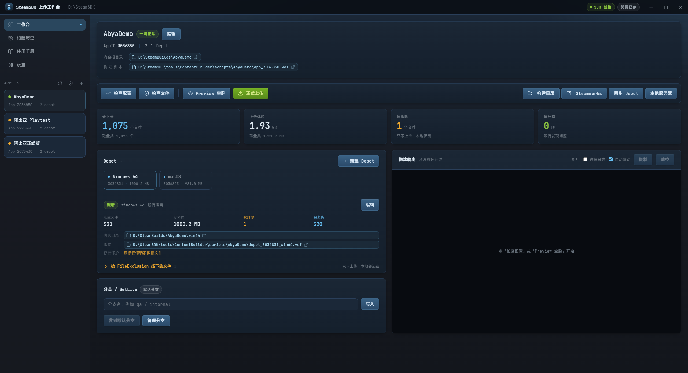
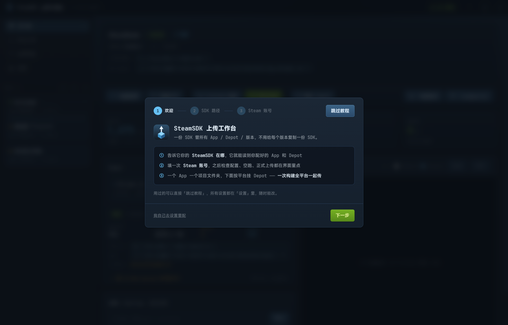
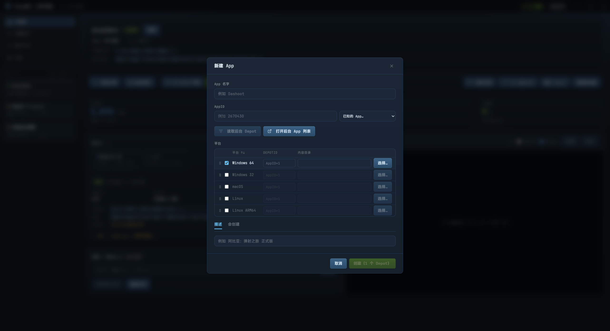
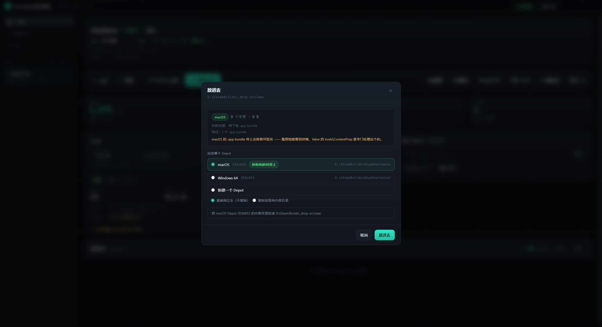
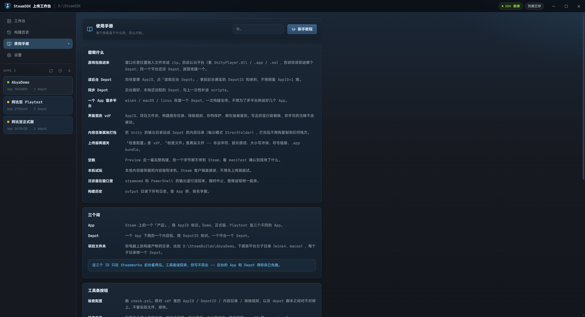

# SteamSDK 上传工作台

一个给 Steam 开发者用的桌面工具：**一份 SteamSDK 管所有 App / Depot / 版本**，不用给每个版本复制一份 SDK，也不用记 steamcmd 的命令行。

界面参考 Steam 自己的视觉风格，Vue 3 + Electron，Windows 免安装包。

> **下载**：[最新版本](https://github.com/yingyu4451/SteamSDK-Tool/releases/latest) —— 装完第一次打开会有三步引导。

[English](README.en.md) · **中文**



---

## 它解决什么问题

用 SteamPipe 上传游戏，官方给的是 `steamcmd` + 一堆 `.vdf` 文件。真上手会碰到这些事：

- 一个游戏有 Demo / 正式版 / Playtest，好像要建好几个 App 文件夹、复制好几份 SDK；
- Windows、macOS、Linux 三个平台要传，得维护三套 depot 配置；
- 后台配的 DepotID 是什么、有没有传成功、本地跟后台对不对得上，全靠翻网页；
- 打包出来的调试文件（`*.pdb`、日志、Burst 调试信息、玩家存档）一不留神就传上去了。

这个工具把这些收进一个界面：**一个 App 一个项目文件夹，下面按平台挂 Depot，一次构建全平台一起传。**

---

## 快速开始

1. 下载并运行 `SteamSDK Tool-x.y.z-setup.exe`；
2. 第一次打开跟着三步引导走：**① 确认 SteamSDK 路径 → ② 填 Steam 账号 → ③ 新建或选一个 App**；
   - 老用户可以直接点「跳过教程」，所有设置都在「设置」页；
3. 点「读取后台 Depot」，它会列出 Steamworks 后台这个 App 下**已经配好的 Depot**，勾上就自动填好 DepotID；
4. 点「检查配置」确认配置没问题，点「Preview 空跑」走一遍完整流程但不真的上传；
5. 没问题了点「正式上传」。

<table>
<tr>
<td width="50%"><br><sub>首次运行的三步引导，老用户可以直接跳过</sub></td>
<td width="50%"><br><sub>新建 App：读后台真实 DepotID，平台可拖动排序</sub></td>
</tr>
</table>

---

## 核心概念

| 概念 | 是什么 |
|---|---|
| **App** | Steam 上的一个「产品」，有唯一的 AppID。Demo、正式版、Playtest 是**不同的 App**，各有各的 AppID |
| **Depot** | App 下面按平台（或按 DLC、语言）拆分的上传单元。**一个平台一个 Depot**，各有各的 DepotID |
| **项目文件夹** | 这个 App 所有平台构建产物的父目录，比如 `D:\SteamBuilds\AbyaDemo`；下面 `win64\`、`macos\`、`linux\` 各绑一个 Depot |
| **分支 / SetLive** | SteamPipe 的 beta 分支。`SetLive` 决定构建发布到哪个分支，**默认分支不能设**，要先去 Steamworks 后台建分支 |
| **空跑（Preview）** | 完整走一遍构建流程，但不上传任何东西。用来验证配置和排除规则 |

### 目录长这样

```text
D:\SteamSDK\tools\ContentBuilder\
├─ build.ps1 / check.ps1        ← 真正的构建和校验逻辑都在这两个脚本里
├─ builder\                     ← steamcmd
├─ output\                      ← 构建日志
└─ scripts\
   ├─ AbyaDemo\                 ← 一个 App 一个文件夹
   │  ├─ app_3036850.vdf
   │  ├─ depot_3036851_win64.vdf
   │  └─ depot_3036853_macos.vdf
   └─ 阿比亚正式版\
      └─ ...
```

> 命令行和界面走的是**同一套脚本**，不会出现「界面上能跑、命令行跑不了」的分叉。想脱离界面用 `D:\SteamSDK\tools\ContentBuilder\build.ps1 -App AbyaDemo` 也行。

---

## 功能

### 多 App、多平台

- 侧栏「＋」新建 App：填名字 + AppID，勾要哪些平台，DepotID 自动按 `AppID+1`、`+2`… 排；
- **平台行可以拖动排序**，从上到下就是 DepotID 的顺序，拖到哪一行立刻换到哪一行；
- 一个 App 下可以挂任意多个平台的 Depot，一次 `run_app_build` 全传；
- App 名字随时能改，**连 `scripts\` 下的文件夹一起改**。

### 读取后台真实 DepotID

不用 Steamworks 管理员权限，也不需要申请 Web API 密钥 —— 它调用你已经在用的 `steamcmd +app_info_print`，用你保存的账号读回后台配置：

| DepotID | 平台 | 构建 | 体积 |
|---|---|---|---|
| 3036851 | Windows 64 | 8650706403037703068 · public | 1.3 GB |
| 3036852 | Linux | 7141745897605008214 · public | 270.6 MB |
| 3036853 | macOS | 2851455297450281867 · public | 996.3 MB |

如果你有 Publisher 级别的 Web API 密钥，在设置里填上会优先走官方接口（能多拿到权限范围内的 App 列表和构建历史）。没有也完全不影响使用。

### 同步 Depot

「同步 Depot」会拿后台的 Depot 列表跟本地脚本对比：

- 后台有、本地没有 → 勾上就自动补一个 depot 脚本（内容目录默认放在项目文件夹下的平台子目录）；
- 本地有、后台没有 → 标出来，说明这个 DepotID 在后台不存在，传上去会失败。

### 拖进来就能放

把**文件夹或 zip 压缩包**直接从资源管理器拖到窗口里：

1. 自动分析是哪个平台（`.app` bundle / `UnityPlayer.dll` / `UnityPlayer.so` / `UnityPlayer` 的 dylib）、有多少文件、多大、有哪些该排除的垃圾；
2. 弹窗让你选放进哪个 Depot（同平台的会标「和你拖的对得上」），没有合适的就**新建一个 Depot**；
3. 选「直接指过去」（把内容目录改成这个文件夹，不复制）或「复制进现有内容目录」。

zip 会被解到临时目录，解完如果只套了一层同名文件夹会自动往下钻。当前只支持 `.zip`（`.7z` / `.rar` 需要先手动解压）。



### 检查文件

「检查文件」按钮扫的是**「检查配置」看不见、但传到 Steam 上会出问题**的东西：

- 文件名里的非法字符、超长路径（相对路径 > 200 字符或单段 > 120 字符）；
- 大小写冲突（`Readme.txt` 和 `README.TXT` 同时存在 —— Steam depot 区分大小写，Windows 玩家下载会撞车）；
- 符号链接 / junction；
- macOS 的 `.DS_Store`、`._*`、`__MACOSX`；
- `.app` bundle 里没有可执行文件，或含有符号链接（Valve 官方的 `tools\ContentPrep` 专门处理这个，macOS 上运行）；
- 空目录。

### 内容体检

每个 Depot 卡片上直接给四个数：**磁盘文件 / 总体积 / 被排除 / 会上传**。点开能看到：

- 真正会被上传的可疑文件；
- 被 `FileExclusion` 挡下的文件，按规则分组。

### 构建与历史

- 「检查配置」跑 `check.ps1`，输出实时流回界面；
- 「Preview 空跑」走完整流程但不上传；
- 「正式上传」要**二次点击确认**；
- 「中止」会杀掉整棵进程树（steamcmd 也一起）；
- **构建输出控制台每个 App 独立**，切 App 就切日志；
- 构建历史按「全部 / 每个 App」筛选，可搜索。

### 编辑器不会毁掉你的 vdf 注释

读走解析器，写走**行级替换**。所以你在 vdf 里手写的注释、Valve 模板里的说明，改完设置后原样还在。

如果改成「解析成对象再重新序列化」，这些注释会全部消失 —— 这是这个工具特意避开的一条路。

### 上传之后

- 状态灯三态：**绿**=没问题，**黄**=有待处理项，**红**=配置有硬伤（AppID 缺失、Depot 脚本丢失、AppID 撞车）；
- 「待处理」每一条都能**单独忽略**（比如那个 Depot 就是故意指向 `Downloads` 的），设置持久化，随时能恢复；
- Depot 内容目录、构建脚本等路径都能**点开**（资源管理器里定位）。

### 界面里有一份使用手册

侧栏「使用手册」是应用内置的，不联网也能看：每个按钮分别在查什么、三个核心概念、什么不该传、分支怎么用。上面有搜索框，按关键词过滤章节。



第一次用可以直接点手册右上角的「新手教程」，从头走一遍设置流程（找 SDK → 填账号），以后想再看一遍也随时能点。

### 关于名字里的空格

App 名字就是 `scripts/` 下的文件夹名，**可以有空格和括号** —— Valve 自己的例子（`ABYA-PB Steam(Body-2670430) B0.7.9`）就带空格。不能用的只有 `\ / : * ? " < > |`、控制字符，以及开头的下划线（`_` 开头的目录会被扫描跳过）。

---

## 凭据是怎么处理的

- 密码用 **Windows DPAPI**（Electron `safeStorage`）加密后落在本机，只有当前 Windows 用户能解；
- **不写进命令行参数**，通过环境变量传给 `build.ps1`，再由 PowerShell 管道灌进 steamcmd 的 stdin；
- 输出里如果出现密码会被替换成 `********`；
- 不想存也行 —— 每次正式上传时界面会问你要。更省事的做法是点「登录一次」，在弹出的真控制台里 `login` 一次，steamcmd 自己会缓存凭据。

Web API 密钥（可选）同样用 DPAPI 加密存在本机。

---

## 更新

工具会读 GitHub Releases 检查新版本：设置页「关于」里能看到当前版本和「检查更新」，标题栏出现 `vX.Y.Z 可更新` 就说明有新版本，点进去一键下载、重启安装。

检查更新走的是 `releases.atom` 和 release 页面，**不用 GitHub API**（API 匿名限流 60 次/小时/IP，一份工具传给一个办公室的人就会集体失效）。

### 两种版本

| | `-setup.exe` | `-portable.exe` |
|---|---|---|
| 装法 | 双击安装，有开始菜单和卸载项 | 双击直接跑，不装、不写注册表 |
| 权限 | 可选装到当前用户目录 | 不需要管理员 |
| 更新 | 应用里点「重启并安装」自动替换 | 点「打开下载位置」，关掉工具自己替换 exe |

便携版覆盖不了正在运行的自己，所以更新只能手动替换 —— 应用里会说明这一点，检查更新时也只会下载对应的那种包。

### 发新版本（给自己看）

推一个 `v*` tag 就会自动构建两种包并建 Release，见 `.github/workflows/build.yml`。本地手动发也走同一条路：

```powershell
# 1. 改 package.json 的 version，比如 0.2.0
# 2. 构建 + 打包（两种包一起出）
pnpm build
$env:ELECTRON_BUILDER_BINARIES_MIRROR='https://npmmirror.com/mirrors/electron-builder-binaries/'
$env:ELECTRON_MIRROR='https://npmmirror.com/mirrors/electron/'
pnpm dist
# 3. 发 release —— tag 必须写成 vX.Y.Z，更新器按这个找
gh release create v0.2.0 --title "v0.2.0" --notes-file NOTES.md `
  "release\SteamSDK Tool-0.2.0-setup.exe" "release\SteamSDK Tool-0.2.0-portable.exe"
```

> 两个包都传。只传 setup 的话，便携版用户拿到的会是安装包 —— 能下但不对路。

**更新日志写短一点。** 它在「关于」卡片里是直接铺开显示的，写成长文没人看。一两句话点明「这次改了什么、用户能感觉到什么」就够了 —— 需要细节就让用户点「在 GitHub 上看」。

```markdown
- 工具条按钮不再把页面顶下去，改成浮层
- 新建 Depot 走右侧边栏，字段和 Steamworks 后台对齐
- 便携版的更新改成「打开下载位置」，不再假装能自己换掉自己
```

---

## 设置项

| 项 | 说明 |
|---|---|
| SDK 路径 | 含 `tools\ContentBuilder` 的那个目录，比如 `D:\SteamSDK` |
| Steam 账号 | 上传构建用的账号名（不是邮箱） |
| 密码 | 可选，DPAPI 加密存本机 |
| Web API 密钥 | 可选，Publisher 级别，填了优先走官方接口 |
| 本地内容服务器 | 用 SDK 自带的 `ContentServer\` 起一个本地 HTTP 服务，配合 Steam 客户端的 `@localcontentserver` 做不上传的本地测试 |

---

## 已知限制

- **`SetLive` 不能设成 `default`** —— Valve 的限制，要发布到默认分支得去 Steamworks 后台点；
- **`FileExclusion` 挡不住空目录** —— 空目录壳还是会进 manifest；
- **`LocalPath "*"` + `DepotPath "."` 会多套一层同名文件夹**，介意的话要写多条 FileMapping 手动映射；
- 后台只能读不能写：删除 / 重命名 Depot 得去 Steamworks 网页后台做，本地改了 DepotID 只是改脚本，不会同步到后台；
- 拖放解压只支持 `.zip`；
- 本地内容服务器默认端口 80，跟 Steam 客户端可能撞，可以在设置里换。

---

## 技术栈与开发

Vue 3 + Electron + Tailwind CSS v4 + GSAP，图标用 [Lucide](https://lucide.dev)（`@lucide/vue`），构建用 electron-vite，打包用 electron-builder。

```powershell
pnpm install
pnpm dev          # 开发（注意：改主进程后热重载不可靠，建议用 pnpm build 后直接跑 out/）
pnpm build        # 构建到 out/
pnpm dist         # 出安装包到 release/
```

主进程代码在 `src/main/`：

| 文件 | 干什么 |
|---|---|
| `index.js` | 主进程入口 + 所有 IPC |
| `vdf.js` | VDF 解析器（读） |
| `vdf-edit.js` | 行级 VDF 编辑（写）+ 模板生成 |
| `sdk.js` | App / Depot 的增删改查、路径检查、扫描 |
| `steamapi.js` | Steamworks Web API（需要 publisher 密钥） |
| `steamcmdinfo.js` | `steamcmd +app_info_print` 解析（**不需要密钥**） |
| `preflight.js` | 检查文件：扫真正会被上传的文件 |
| `dropzone.js` | 拖放分析（文件夹 / zip） |
| `localserver.js` | 本地内容服务器 |
| `updater.js` | GitHub Releases 检查更新 |
| `runner.js` | 跑 PowerShell / steamcmd，流式回传输出 |
| `store.js` | 设置与凭据持久化 |

---

## 常见问题

**界面显示「SDK 未就绪」**
设置页里 SDK 路径要指向含 `tools\ContentBuilder` 的目录；`builder\steamcmd.exe` 不在的话先跑一次 `steamcmd.exe` 让它自更新。

**「正式上传」跑完什么都没传**
看 app vdf 里的 `"preview"` 是不是 `1`。现在这个值由按钮决定（点「正式上传」会强制写成 0），但如果你手改过脚本要注意。

**「检查配置」说「Depot 引用的脚本不存在」**
app vdf 里 depot 的路径写错了。绝对路径和相对文件名都支持。

**待处理项里有「Depot X 上传的是 ... 不在项目文件夹里」**
这个 Depot 的内容目录跑到项目文件夹外面去了（常见于指向 `Downloads`）。如果是有意为之，点「忽略」；不是的话去 Depot 卡片里改内容目录。

---

## 反馈

有 bug 或者想要的功能，开个 [Issue](https://github.com/yingyu4451/SteamSDK-Tool/issues)。
